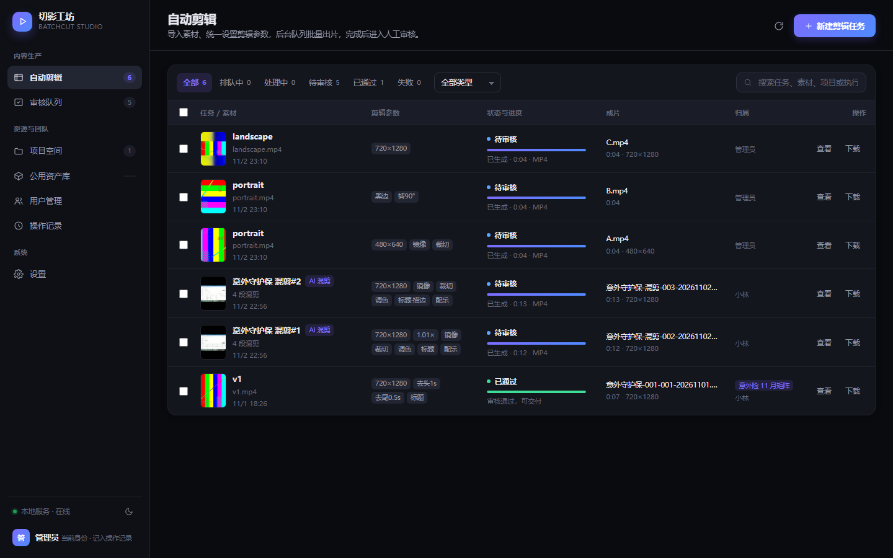
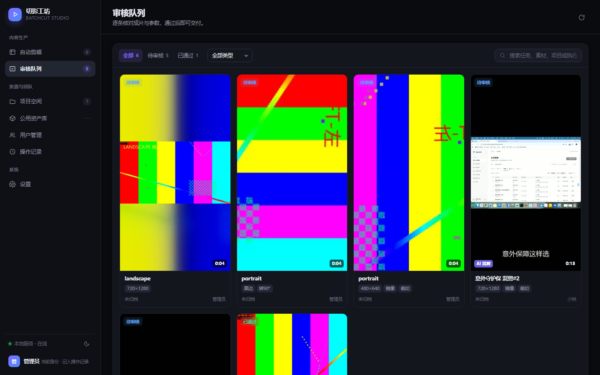
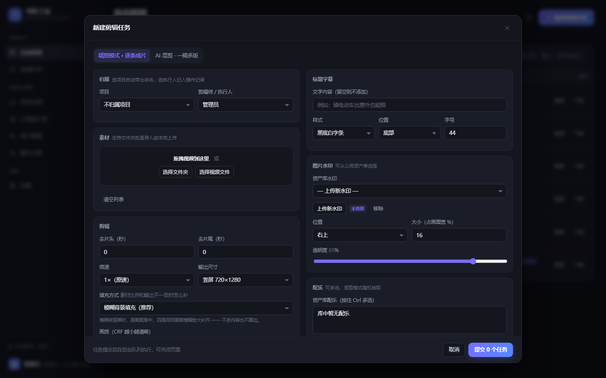
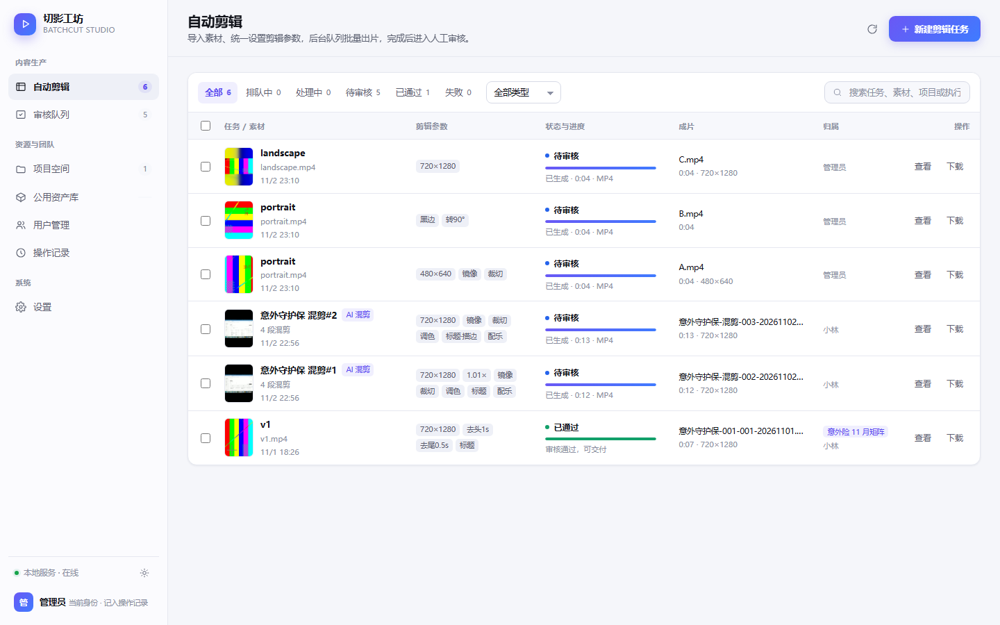

# 切影工坊 BatchCut Studio

> 网页版**视频批量剪辑工厂**：批量建任务 → 后台队列自动剪辑 → 人工审核 → 规范化交付。
> 纯 **Python 标准库**实现，零第三方依赖，单机离线可用。



## 它解决什么问题

短视频工厂化生产的典型痛点：几十条素材、同一套剪辑规则、反复人工导出。切影工坊把这条链路完整搬进浏览器：

| 环节 | 能力 |
|---|---|
| **批量建任务** | 文件夹导入 / 拖拽上传，N 个视频共用一套参数，一次提交 |
| **AI 混剪 · 一稿多版** | 自动随机分段（2.5–6.5s）+ 乱序重组，一批素材出 N 条不同成片 |
| **AI 换元素去重** | 每条混剪随机差异化：镜像 / 裁切 / 微变速 / 调色 / 标题文案与样式 / 水印位置 / BGM |
| **AI 前贴** | 片头 / 片尾贴片自动拼接（精剪与混剪均支持） |
| **队列与进度** | 后台多线程执行，实时进度条 + 百分比 + 预计剩余时间，关页面不丢任务 |
| **人工审核** | 成片封面卡片流，网页内直接预览，审核通过 / 退回重剪 / 下载 / 批量打包 zip |
| **项目空间** | 项目沉淀默认命名规则，建任务自动带出；任务按项目统计与过滤 |
| **公用资产库** | 配乐 / 水印 / 片头 / 原生素材（含脚本备注）入库一次、全任务复用 |
| **团队与审计** | 成员与角色管理、当前身份切换；全量操作记录（谁、何时、做了什么） |

## 界面一览

**审核队列 —— 竖版卡片流**（封面即成片画面，状态徽章 + 时长角标 + 快捷操作）



**新建任务 —— 全参数剪辑面板**（精剪 / AI 混剪双模式）



**双主题**：默认深色专业剪辑风，一键切浅色并记忆



## 快速开始

```bash
git clone https://github.com/<你的用户名>/batchcut-studio.git
cd batchcut-studio/batchcut

# 首次运行：自动获取 ffmpeg 到 tools/（或手动放入 ffmpeg.exe）
python tools/fetch_ffmpeg.py

python backend.py 8971
# 浏览器打开 http://127.0.0.1:8971
```

Windows 直接**双击 `batchcut/start.bat`**（自动检测并获取 ffmpeg → 启动 → 打开浏览器）。

- 系统要求：Python 3.9+（其余零依赖）、ffmpeg（启动脚本可自动获取）
- 数据全部落盘在 `batchcut/data/`（状态 JSON 持久化，重启自动续跑未完成任务）

## 剪辑参数一览

- **时长**：去片头 / 片尾、倍速 0.25–4×
- **画面**：水平镜像、旋转 90/180/270、四边裁切、亮度 / 对比度 / 饱和度
- **适配**：输出尺寸预设（720×1280 / 1080×1920 / 横屏 / 方形 / 原尺寸）、填充方式（**模糊背景** / 裁切填满 / 黑边）
- **元素**：中文标题字幕（黑条 / 黄字 / 投影 / 描边四种样式，位置与字号可调）、图片水印（位置 / 大小 / 透明度）
- **音频**：BGM 自动循环铺满、与原声混音、音量可调；无音轨素材自动补静音
- **编码**：H.264 + AAC、CRF 可调、`+faststart`
- **命名**：模板自由组合 `{产品}-{编号}-{序号}-{原名}-{日期}-{剪辑}`

## 架构

```
batchcut/
├─ backend.py          # 单文件后端：HTTP 服务 + 任务队列 + ffmpeg 指令编译器
├─ web/index.html      # 单页前端：无构建、无 CDN、离线可用（深/浅双主题）
├─ tools/
│  ├─ fetch_ffmpeg.py  # 首次运行自动获取 ffmpeg（pip 镜像 / 直链兜底）
│  └─ ffmpeg.exe       # 运行时生成，不入库
├─ data/               # state.json 任务状态 + uploads/ + output/ + posters/
└─ start.bat           # Windows 一键启动
```

**核心设计**：任何任务（精剪 / 混剪 / 带片头片尾）在创建时统一编译为**片段序列**（每段 = 素材 + 起点 + 时长 + 段内预处理），执行引擎走单一流水线：

```
逐段归一化(crop→rotate→scale/fit→fps) → concat → 调色/变速/标题 → 水印 → 配乐混音 → 单次转码输出
```

- 剪辑参数 → ffmpeg `filter_complex` 的编译逻辑集中在 `build_segments_command()`
- 进度解析 ffmpeg `-progress` 输出，实时回写百分比与 ETA
- 封面缩略图在出片时预生成（`/api/poster` 按路径 + mtime 缓存）
- 并发工作线程按设置每 2 秒自动伸缩，改并发即时生效

## HTTP API（本机 127.0.0.1）

| 方法 | 路径 | 说明 |
|---|---|---|
| GET | `/api/state` | 全量状态（任务/项目/资产/用户/操作记录/设置） |
| POST | `/api/tasks` | 创建任务（`mode: single/remix`、`ops`、`naming`、`remix` 规划参数） |
| POST | `/api/action` | 批量操作：approve / reject / retry / delete |
| POST | `/api/upload` | 分块上传素材 |
| GET | `/api/folder` | 列出本地文件夹内的视频素材 |
| GET/POST | `/api/assets` | 资产库增删 |
| GET/POST | `/api/projects` | 项目增删改 |
| GET/POST | `/api/users` | 用户与角色 |
| GET | `/api/oplog` | 操作记录（含搜索） |
| GET/POST | `/api/settings` | 服务设置（ffmpeg 路径 / 字体 / 并发 / 编码预设） |
| GET | `/api/output` `/api/poster` `/api/media` | 成片流 / 封面图 / 资产流（支持 Range） |
| GET | `/api/zip` | 批量打包下载（重名自动加序号） |

## 路线图

- [ ] 语音识别对齐（口播自动切气口 / 字幕对齐，原工具依赖云端 ASR 的能力）
- [ ] 接入大模型 API：产品卖点 → 自动生成标题库 / 口播脚本（脚本仿写）
- [ ] 预切片段缓存加速大批量混剪
- [ ] SRT 字幕导入与时间轴分段
- [ ] 多机访问（当前仅监听 127.0.0.1）

## 文档

- [工具拆解与版本演进报告](docs/拆解报告.md) —— 参考工具拆解、v1→v5 每个版本的能力与踩坑记录

## License

[MIT](LICENSE)
